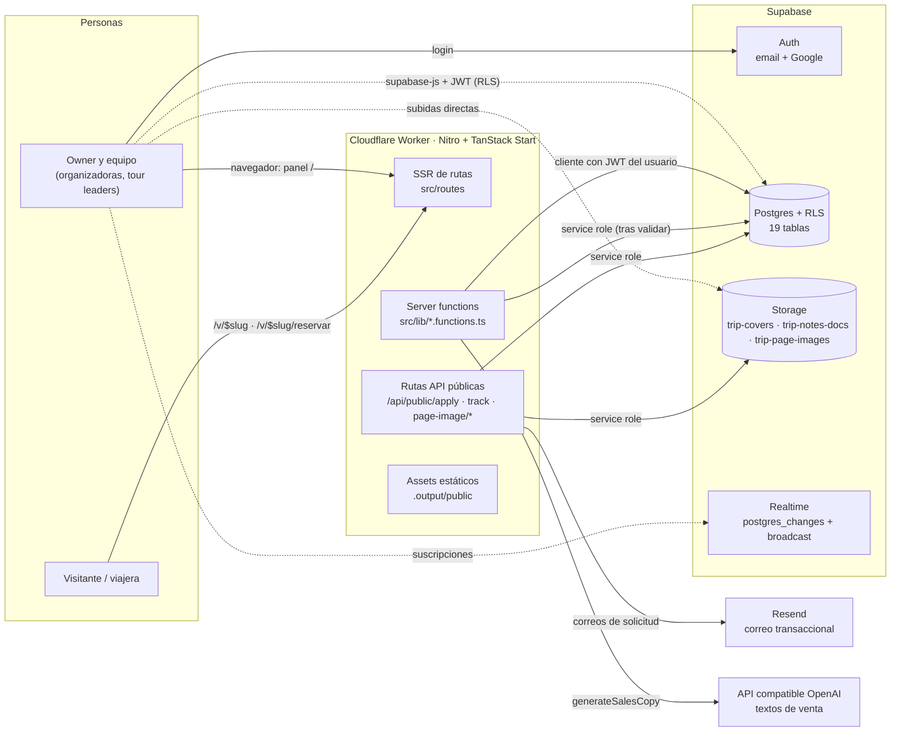
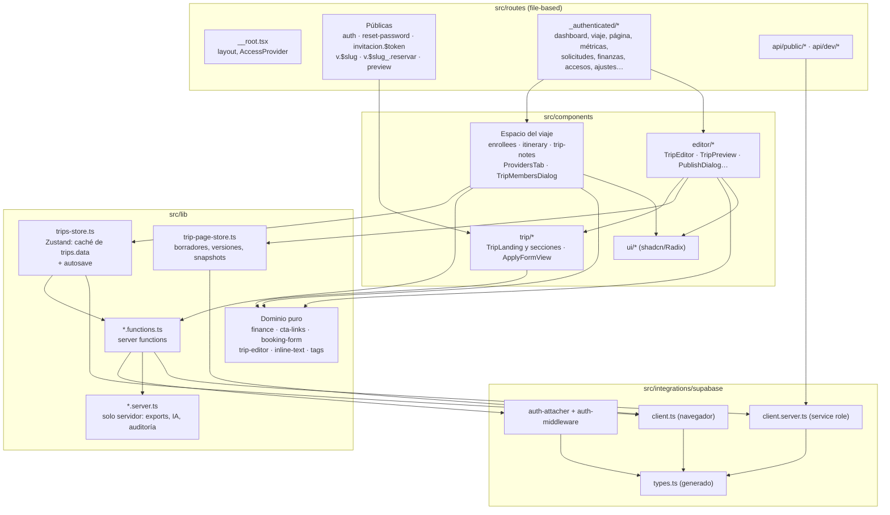
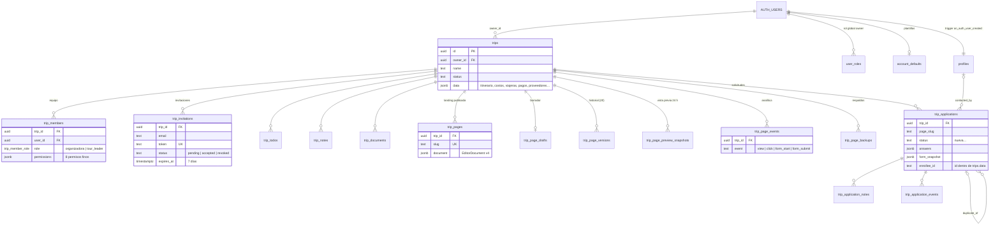
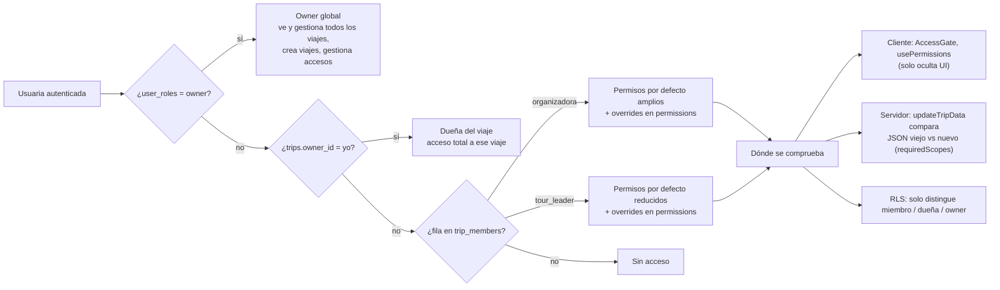
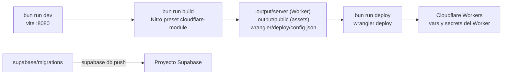

# Arquitectura de Planeii

Grafo vivo de la arquitectura. Si cambiás un módulo, una tabla o un límite entre capas,
actualizá el diagrama correspondiente en el mismo commit. Los flujos paso a paso están en
[flujos.md](flujos.md).

Los diagramas son Mermaid: GitHub los dibuja directamente. Para editarlos con vista previa
podés usar https://mermaid.live.

## 1. Contexto del sistema

Una sola aplicación TanStack Start que se ejecuta como Cloudflare Worker. Sirve el panel de
gestión (privado), las landings de venta (públicas) y unas pocas rutas API. Toda la
persistencia vive en Supabase.

Puntos clave:

- **Dos caminos a la base.** El navegador habla con Supabase directamente (lecturas, notas,
  páginas de venta, subidas) protegido solo por RLS. Las operaciones sensibles pasan por server
  functions que validan el JWT y, si hace falta, usan el cliente con service role.
- **SSR sin sesión.** La sesión vive en `localStorage`; el SSR no la conoce. Por eso el layout
  autenticado tiene `ssr: false` y las landings públicas leen con la clave publicable.
- **Sin backend propio aparte del Worker.** No hay colas, cron ni Edge Functions. La purga de la
  papelera la hace el cliente al cargar.

## 2. Capas del código

Reglas que sostienen esta estructura:

- Los módulos `*.server.ts` y `client.server.ts` nunca se importan desde el cliente. Vite lo
  hace cumplir con `importProtection` en `vite.config.ts`.
- `src/start.ts` registra `attachSupabaseAuth` como middleware global: cada llamada a una
  server function lleva `Authorization: Bearer <jwt>`. `requireSupabaseAuth` valida ese token y
  crea un cliente con RLS del usuario.
- Las reglas del editor de páginas de venta están en [`AGENTS.md`](../AGENTS.md).

## 3. Modelo de datos

Casi todo el negocio de un viaje vive en una sola columna `trips.data` (jsonb): itinerario,
costos, viajeras con sus cuotas y pagos, extras, créditos, proveedores, tags, logística y el
estado de papelera. Las tablas propias son para lo colaborativo (notas, tareas, documentos),
el acceso (miembros, invitaciones, auditoría) y las páginas de venta.

Además, sin relación declarada:

- `access_audit_log` registra cambios de acceso (actor, destinatario, viaje). Solo la escribe el
  servidor con service role.
- `trip_documents.storage_path` apunta a un objeto de `trip-notes-docs`; `trips.data.coverImage`
  a `trip-covers`; las imágenes dentro de `trip_pages.document` a `trip-page-images`.

Todas las migraciones están en `supabase/migrations/` y se aplican en orden con
`supabase db push`. La última, `20261015120000_self_hosting_storage_and_grants.sql`, crea lo que
en Lovable se configuró fuera de los archivos.

## 4. Modelo de permisos

Los 8 permisos finos están en `src/lib/trip-permissions.ts`. La base de datos no los conoce:
solo los aplica `updateTripData`. Ver los riesgos que esto abre en [estado.md](estado.md).

## 5. Despliegue

