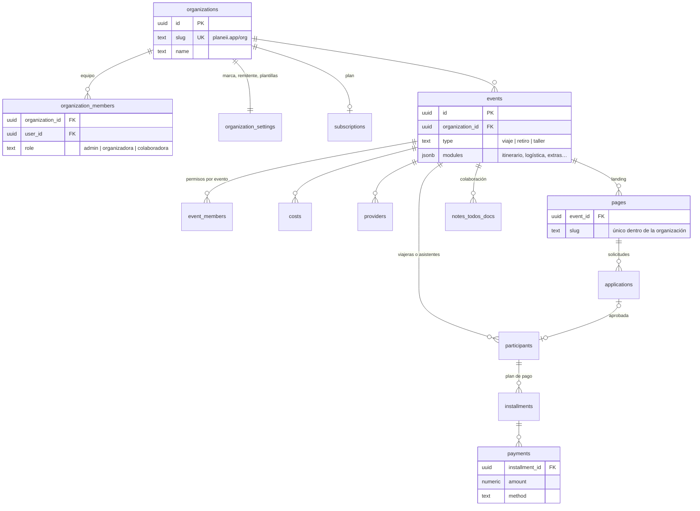
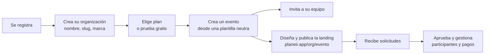
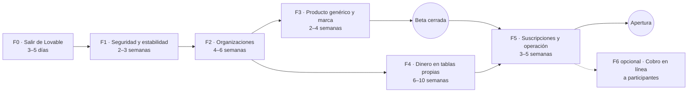

# Evaluación: salir de Lovable y convertir PlanEII en plataforma

Análisis del repositorio a octubre de 2026 para decidir dos cosas:

1. Si vale la pena sacar PlanEII de Lovable y qué implica.
2. Qué haría falta para que otras organizadoras creen y gestionen sus propios eventos en
   PlanEII, en lugar de ser la herramienta interna de una sola empresa.

Los detalles técnicos de respaldo están en [estado.md](estado.md), [arquitectura.md](arquitectura.md)
y [flujos.md](flujos.md).

## Resumen

**Sí conviene salir de Lovable, y conviene hacerlo antes de abrir PlanEII a otras organizadoras.**

- **Salir ya es barato.** El código ya está migrado en la rama `migracion-fuera-de-lovable`.
  Lo que falta es configurar cuentas y mover los datos: unos días de trabajo, no semanas.
- **El trabajo grande es otro.** Convertir PlanEII en plataforma exige rediseñar quién puede ver
  qué, separar los datos de cada organización y corregir problemas de seguridad que hoy no
  importan porque todas las usuarias son del mismo equipo. Ese trabajo es difícil de hacer bien a
  base de prompts en Lovable, y es justo donde un repo propio con revisión y tests ayuda.
- **No hace falta reescribir.** El editor de páginas de venta, el motor de cuotas y créditos, las
  notas y el formulario de solicitudes son valiosos y están pulidos. Lo que hay que rediseñar es
  la capa de datos y permisos, no la interfaz.

| Etapa | Esfuerzo estimado |
|---|---|
| Terminar de salir de Lovable | 3 a 5 días |
| Primera beta cerrada con unas pocas organizadoras externas: fases F0 a F3 | 2 a 3,5 meses |
| Plataforma abierta con cobro de suscripciones: fases F0 a F5 | 4 a 7 meses |

Las estimaciones son orden de magnitud para una persona desarrolladora con experiencia en este
stack, a tiempo completo y con apoyo de herramientas de IA. Dependen de las decisiones de la
sección 6.

## 1. Qué existe hoy

| Área | Líneas | Madurez | Veredicto |
|---|---|---|---|
| Editor de páginas de venta y landing pública | ~5.000 (muy densas) | Alta: 38 iteraciones documentadas, reglas de arquitectura propias | **Mantener.** Es lo más diferencial |
| Formulario de solicitud, panel de solicitudes, métricas | ~1.100 | Media-alta | **Mantener**, con ajustes por organización |
| Espacio del viaje: costos, viajeras, cuotas, pagos, créditos, extras | ~15.400 + 6.900 de componentes | Alta en funcionalidad, baja en estructura | **Refactorizar.** La lógica sirve; la forma de guardarla no escala |
| Notas, tareas y documentos | incluido arriba | Media-alta, tablas propias | **Mantener** |
| Accesos: miembros, invitaciones, bitácora | ~3.900 | Media | **Rediseñar** alrededor de organizaciones |
| Exportaciones PDF y Excel | ~570 | Media | **Mantener** |
| Menú global: Itinerarios, Proveedores, Pagos, Reportes, CRM | Vacías | Nula | Decidir si se construyen o se quitan |
| Base de datos: 19 tablas, RLS | ~1.200 de SQL | Funciona, pero con permisos laxos | **Rediseñar** permisos y tenencia |

Lo más valioso del repo no son las líneas sino las decisiones de producto ya probadas con un
negocio real: cómo se cobran cuotas, cómo se reasignan créditos entre viajes, qué necesita una
landing para vender un viaje grupal.

## 2. ¿Vale la pena salir de Lovable?

### Lo que falta para salir

El código ya no depende de Lovable. Quedan pasos de infraestructura, detallados en
[migracion.md](migracion.md):

1. Crear un proyecto Supabase y restaurar la exportación oficial de Lovable Cloud.
2. Copiar los archivos de Storage y configurar el login con Google.
3. Bajar las fotos de la plantilla de Oaxaca.
4. Configurar Resend para los correos y la API de IA.
5. Desplegar en Cloudflare Workers y mover el dominio.

Lovable ofrece una exportación oficial de la base hacia un Supabase propio. Las guías no
coinciden en si conserva las contraseñas, así que hay que contar con que algunas personas tengan
que restablecerla. Fuentes en [migracion.md](migracion.md).

### Comparación

| Criterio | Quedarse en Lovable | Plataforma propia |
|---|---|---|
| Velocidad para cambios de interfaz | Muy alta, sin programar | Alta con un desarrollador o con Claude Code sobre el repo |
| Cambios profundos: permisos, tenencia, migraciones de datos | Riesgosos: cada prompt reescribe partes sin revisión ni tests | Se diseñan, revisan y prueban |
| Control de la base | Limitado; varias cosas se hicieron fuera de los archivos | Total, todo versionado en `supabase/migrations` |
| Dependencias ocultas | Registro npm privado, CDN de imágenes, login de Google, dominio de correo y créditos de IA dentro de Lovable | Proveedores estándar e intercambiables |
| Calidad del código | Crece sin control: un archivo ya tiene 10.000 líneas | Revisión, lint y tests en cada cambio |
| Costo de infraestructura | Plan más créditos; hosting, IA y conectores consumen el mismo saldo | Suma de servicios, ver tabla |
| Quién lo mantiene | Gaby, con prompts | Hace falta alguien con perfil técnico |

### Costos mensuales aproximados

Precios de guías de terceros de 2026; verifícalos en las páginas oficiales antes de presupuestar.

| Servicio | Plan | Costo de referencia |
|---|---|---|
| Lovable (situación actual) | Pro | desde 25 USD al mes más créditos adicionales |
| Supabase | Pro | 25 USD al mes, con cómputo pequeño incluido |
| Cloudflare Workers | Paid | 5 USD al mes, 10 millones de peticiones |
| Resend | Free o Pro | 0 USD hasta 3.000 correos; 20 USD hasta 50.000 |
| IA | Según uso | Variable; hoy sale de los créditos de Lovable |

La infraestructura propia arranca en unos 30 a 50 USD al mes. El costo de infraestructura no es
lo que decide: lo que decide es el tiempo de desarrollo, y ese tiempo rinde más fuera de Lovable
para el tipo de cambios que necesita una plataforma.

Fuentes de precios: [uxmagic.ai](https://uxmagic.ai/blog/lovable-pricing),
[sitebuilderreport.com](https://www.sitebuilderreport.com/lovable-pricing),
[makerkit.dev](https://makerkit.dev/pricing-calculator/supabase),
[jetadmin.io](https://www.jetadmin.io/blog/supabase-pricing-2026-guide-to-plans-limits-and-real-world-costs/),
[developers.cloudflare.com](https://developers.cloudflare.com/cloudflare-for-platforms/workers-for-platforms/reference/pricing/index.md),
[automationatlas.io](https://automationatlas.io/answers/resend-pricing-explained-2026/).

### Lo que se pierde

Gaby pierde el flujo de pedir cambios en lenguaje natural y verlos al instante. Hay dos formas
de compensarlo:

- **Trabajar con un agente sobre el repo**, por ejemplo Claude Code, con revisión antes de
  publicar. El repo ya trae `CLAUDE.md` y la documentación para eso.
- **Usar Lovable solo como borrador** de pantallas nuevas y pasar el resultado al repo a mano.
  No conviene seguir editando el mismo proyecto en los dos lados: divergen rápido.

## 3. De herramienta interna a plataforma: qué falta

Ordenado por lo que bloquea primero.

1. **No existe el concepto de organización.** Todo gira alrededor de un rol global `owner` que ve
   y gestiona todos los viajes. Se consulta en unas 60 líneas de 13 archivos y aparece 29 veces en las
   migraciones de la base.
   Una persona que se registra sin invitación ve "Todavía no tenés viajes asignados" y no puede
   crear nada (`src/lib/access.tsx`, `createTrip` en `src/lib/trips.functions.ts`). Con varias
   organizadoras, ese rol global vería los datos de todas.
2. **La base de datos no hace cumplir los permisos.** Cualquier miembro de un viaje puede escribir
   la fila completa directamente, saltándose los permisos finos que solo revisa una server
   function. Hay además XSS almacenado en notas de costo. Dentro de un equipo es un riesgo; entre
   organizaciones distintas sería una filtración. Detalle en [estado.md](estado.md#seguridad).
3. **Todo el evento vive en un JSON y la lógica de dinero corre en el navegador.** Viajeras,
   cuotas, pagos, costos y proveedores van en `trips.data`. Las 103 acciones del store calculan
   montos en el cliente y el servidor guarda lo que recibe tras revisar permisos, no montos. Gana
   la última escritura, y cada cambio recarga todos los viajes. Con pocas usuarias funciona; con
   muchas organizaciones trae pérdidas de cambios, reportes imposibles entre eventos y poca
   confianza en las cifras.
4. **La marca y los textos son de Chama Viaja.** "PLANEI OS" en la app, "CHAMA VIAJA" en el correo
   a viajeras, remitente `chamaviaja.com`, el prompt de IA escrito para "viajes grupales para
   mujeres" y plantillas con contenido de Oaxaca y Catatumbo.
5. **Las URLs públicas comparten un solo espacio.** El slug de cada landing es único en toda la
   base (`/v/$slug`). No hay espacio por organización ni dominios propios.
6. **No hay cobro a organizadoras ni límites.** No existen planes, suscripciones ni cuotas de uso.
   Cualquier cuenta con sesión puede gastar la API de IA del proyecto.
7. **Los cobros a participantes son manuales.** Se registran a mano; los "presets de Stripe" solo
   calculan comisiones. Una plataforma probablemente necesite cobro en línea.
8. **Operación pensada para un equipo.** La purga de la papelera la hace el navegador de quien
   abre la app, los archivos quedan huérfanos, no hay tareas programadas, monitoreo ni tests de
   permisos.
9. **Datos personales sensibles sin marco legal.** Se guardan teléfonos, vuelos, seguros y fotos
   de pasaporte. Los enlaces de términos y privacidad de la landing apuntan a `#`. Con terceros
   como organizadoras, PlanEII pasa a tratar datos por cuenta de otras empresas.
10. **El producto es de viajes, no de eventos en general.** Itinerario por días, vuelos, seguro,
    monedas por destino y tipo de cambio son propios de viajes. Retiros o talleres encajan casi
    igual; eventos con entradas o asientos serían otro producto.
11. **Idioma y moneda fijos.** Textos en español rioplatense con voseo, cuando el público es
    venezolano y debería ser español neutro con tú; no hay sistema de traducción. Además, 9 monedas
    en una lista fija y unos 164 montos formateados siempre como USD.

## 4. Arquitectura objetivo

La organización pasa a ser el límite de todo: cada dato pertenece a una organización y la base lo
hace cumplir.

Principios:

- **Tenencia en la base.** Cada tabla lleva `organization_id`, o lo hereda del evento, y las
  políticas RLS se basan en la membresía a la organización. El rol de plataforma para soporte se
  separa del rol de administradora de una organización.
- **El dinero se calcula en el servidor.** Cuotas, pagos y créditos pasan a tablas propias y a
  server functions que validan montos. El JSON queda para lo que de verdad es documento: la
  landing y la configuración del evento.
- **Eventos con módulos.** Un evento de tipo viaje activa itinerario y logística; un retiro o un
  taller pueden no hacerlo, sin bifurcar el código.
- **Marca por organización.** Nombre, logo, colores, remitente de correo y plantillas salen de la
  configuración de cada organización.

Recorrido de una organizadora nueva:

## 5. Plan por fases

| Fase | Objetivo | Trabajo principal | Listo cuando |
|---|---|---|---|
| **F0 · Salir de Lovable** | Que Chama Viaja funcione igual en infraestructura propia | Pasos de [migracion.md](migracion.md); congelar el proyecto en Lovable | La lista de comprobación pasa en producción y el dominio apunta al Worker |
| **F1 · Seguridad y estabilidad** | Que la base haga cumplir los permisos | Escrituras de `trips` solo por el servidor; RLS de miembros; sanear HTML; analítica solo por servidor; mostrar errores de guardado; control de versión para evitar pisar cambios; tests de permisos; formatear y partir el archivo de 10.000 líneas | Un miembro sin permiso no puede cambiar nada fuera de su alcance, ni siquiera llamando a la API directamente |
| **F2 · Organizaciones** | Varias organizaciones aisladas entre sí | Tablas de organización y membresía; `organization_id` en todo; RLS por organización; migrar Chama Viaja como primera organización; registro con alta de organización; accesos por organización; landings bajo `/org/slug`; ajustes por organización | Dos organizaciones de prueba no ven nada la una de la otra, verificado con tests |
| **F3 · Producto genérico y marca** | Que cualquier organizadora lo sienta propio | Marca, remitente y plantillas por organización; prompt de IA configurable; plantillas neutras; tipos de evento y módulos; quitar o construir las secciones vacías; formato de moneda correcto | Una organizadora externa crea y publica un evento sin ver nada de Chama Viaja |
| **F4 · Dinero en tablas propias** | Cifras confiables y reportes entre eventos | Participantes, cuotas, pagos, créditos y costos en tablas; reglas de cálculo en el servidor; migrar los JSON existentes; reportes globales | Los totales de todas las vistas salen de la base y coinciden con los datos migrados |
| **F5 · Suscripciones y operación** | Cobrar a organizadoras y operar sin sustos | Planes y cobro con Stripe; límites por plan, incluida la IA; tareas programadas para purgas y limpieza de archivos; monitoreo de errores; copias de seguridad; términos, privacidad y acuerdo de tratamiento de datos | Una organizadora se suscribe, paga y opera sola; hay alertas ante errores |
| **F6 · Cobro en línea a participantes** (opcional) | Que las viajeras paguen cuotas en línea | Stripe Connect o similar por organización; conciliación con cuotas | Un pago en línea marca la cuota sin intervención manual |

Sobre el orden:

- **F1 y F2 son innegociables antes de dejar entrar a cualquier organizadora externa.**
- **F4 es la fase más cara.** Para la beta se puede postergar si F1 agrega control de versión al
  guardado; con pocas organizadoras el JSON aguanta. Conviene hacerla antes de abrir del todo.
- **El editor de páginas de venta casi no cambia en ninguna fase**, salvo para leer la marca de
  la organización y el nuevo esquema de URLs.

## 6. Decisiones para Gaby

Cada una cambia el alcance y el esfuerzo.

1. **¿Qué es un evento?** Si son viajes, retiros y talleres con estructura parecida, el modelo
   actual se generaliza bien. Si incluye eventos con entradas, asientos o miles de asistentes, es
   otro producto.
2. **¿Cómo gana dinero PlanEII?** Suscripción mensual, precio por evento o comisión por
   participante. Define F5 y si F6 es obligatoria.
3. **¿Las participantes pagarán en línea?** Si sí, F6 deja de ser opcional y aparece el tema
   fiscal de cobrar por cuenta de terceros.
4. **¿Marca visible o marca blanca?** ¿Las landings dicen PlanEII o solo la marca de cada
   organizadora? ¿Hacen falta dominios propios por organización?
5. **¿Quién mantiene el código?** Una persona desarrolladora, Gaby con un agente de IA sobre el
   repo, o una combinación con revisión.
6. **¿Mercados, idiomas y monedas?** Solo Latinoamérica en español, o también otros idiomas.
7. **¿Chama Viaja es la primera organización de la plataforma** o sigue en una instancia aparte?

## 7. Riesgos

| Riesgo | Mitigación |
|---|---|
| Abrir a otras organizadoras antes de F1 y F2 y filtrar datos entre ellas | Tratar F1 y F2 como requisito de salida, con tests de aislamiento |
| Reescribir todo desde cero y perder lo que ya funciona | Refactorizar por capas; mantener editor, motor de cuotas y notas |
| Gaby pierde velocidad de iteración | Flujo con agente de IA sobre el repo y despliegues de vista previa por rama |
| Seguir editando en Lovable mientras se trabaja en el repo | Congelar Lovable desde F0; usarlo solo para bocetos |
| Migrar el JSON de dinero con errores | Migración con respaldo, verificación de totales por evento y período de doble lectura |
| Tratar datos personales de terceros sin marco legal | Términos, privacidad y acuerdo de tratamiento de datos antes de la apertura |
