# Flujos implementados

Cada flujo describe lo que hace el código hoy, no lo que debería hacer. Los problemas conocidos
de cada flujo están en [estado.md](estado.md). Si cambias un flujo, actualiza su diagrama en el
mismo commit.

Participantes habituales: **UI** (componente React), **Store** (Zustand, `src/lib/trips-store.ts`),
**SF** (server function), **DB** (Postgres con RLS), **ST** (Storage), **RT** (Realtime).

Índice:

- Acceso: [1. Llamada autenticada](#1-llamada-autenticada-a-una-server-function) ·
  [2. Login e invitación](#2-login-registro-e-invitación) ·
  [3. Gestión de accesos](#3-gestión-de-accesos-owner)
- Espacio del viaje: [4. Carga y sincronización](#4-carga-y-sincronización-de-viajes) ·
  [5. Guardado del viaje](#5-guardado-del-viaje-autosave) ·
  [6. Crear viaje](#6-crear-y-duplicar-viaje) ·
  [7. Costos e itinerario](#7-costos-e-itinerario) ·
  [8. Viajeras y pagos](#8-viajeras-pagos-y-créditos) ·
  [9. Logística](#9-logística-y-adjuntos-de-viajeras) ·
  [10. Notas, tareas y documentos](#10-notas-tareas-y-documentos) ·
  [11. Exportar](#11-exportar-pdf-y-excel) ·
  [12. Papelera](#12-papelera-y-borrado) ·
  [13. Actividad en vivo](#13-actividad-en-vivo)
- Página de venta: [14. Editar](#14-editar-con-autosave-y-deshacer) ·
  [15. Editor e iframe](#15-editor--iframe-por-postmessage) ·
  [16. Vista previa](#16-vista-previa-con-snapshot) ·
  [17. Publicar](#17-publicar-y-servir-vslug) ·
  [18. CTAs](#18-resolución-de-ctas) ·
  [19. Imágenes](#19-imágenes-de-la-landing) ·
  [20. IA](#20-textos-con-ia)
- Recorrido público: [21. Solicitud](#21-solicitud-pública-y-correos) ·
  [22. Analítica](#22-analítica-y-métricas) ·
  [23. Panel de solicitudes](#23-panel-de-solicitudes)

---

## Acceso

### 1. Llamada autenticada a una server function

Todas las server functions usan este camino (`src/start.ts`, `src/integrations/supabase/`).

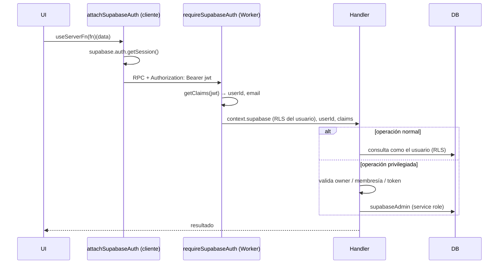

### 2. Login, registro e invitación

`src/routes/auth.tsx`, `src/routes/invitacion.$token.tsx`, `src/lib/trip-invitations.functions.ts`.

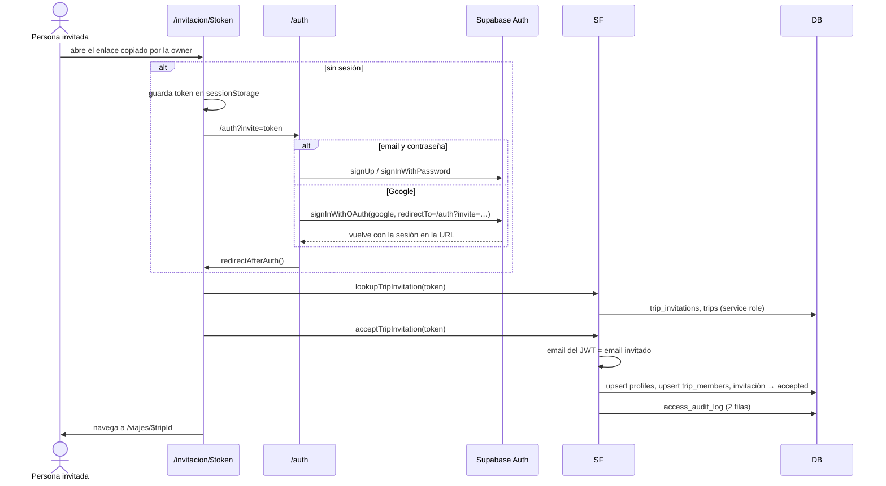

Respaldo: cada vez que se monta el layout autenticado, `acceptMyPendingInvitations` acepta
todas las invitaciones pendientes del email de la sesión. Las invitaciones no se envían por
correo: la owner copia el enlace.

Reset de contraseña: `resetPasswordForEmail` con `redirectTo=/reset-password`, que espera el
evento `PASSWORD_RECOVERY` y llama a `updateUser({ password })`.

### 3. Gestión de accesos (owner)

`/accesos` y `src/lib/admin-access.functions.ts`. Cada acción llama a `assertOwner` y luego usa
service role.

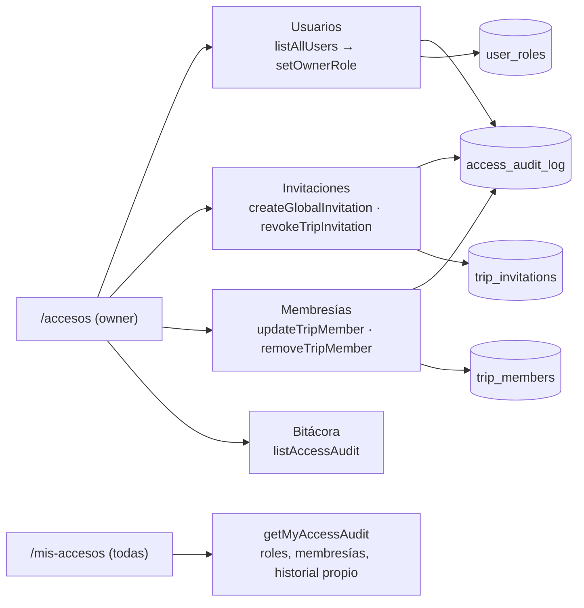

---

## Espacio del viaje

### 4. Carga y sincronización de viajes

`src/routes/_authenticated/route.tsx` (`TripsSyncer`) y `hydrateFromSupabase` en el store.

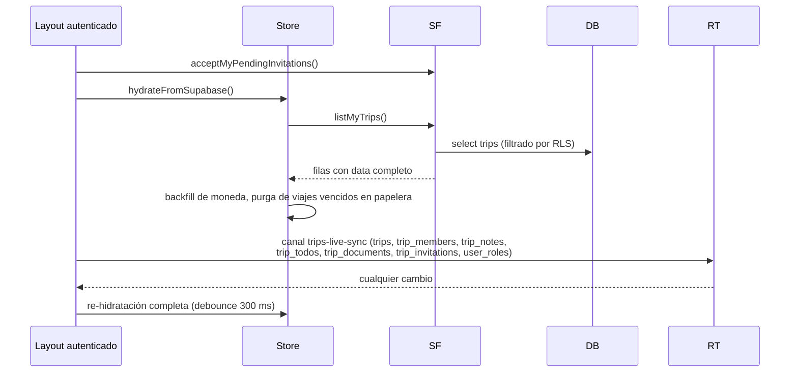

### 5. Guardado del viaje (autosave)

Todo cambio de `trips.data` pasa por aquí (`trips-store.ts`, `trips.functions.ts`).

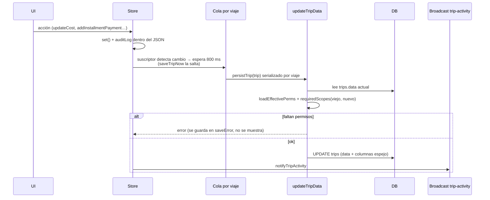

### 6. Crear y duplicar viaje

`src/components/NewTripDialog.tsx`, `createTrip` en `trips.functions.ts`.

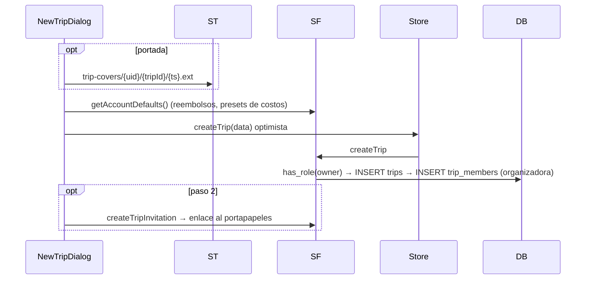

Duplicar (`TripActionsDialogs.tsx`) copia el JSON sin viajeras, miembros ni invitaciones y
reutiliza el mismo flujo.

### 7. Costos e itinerario

Pestaña "Itinerario & Costos" (`CostsTab` en `viajes.$tripId.tsx`). Todo vive en `trips.data`.

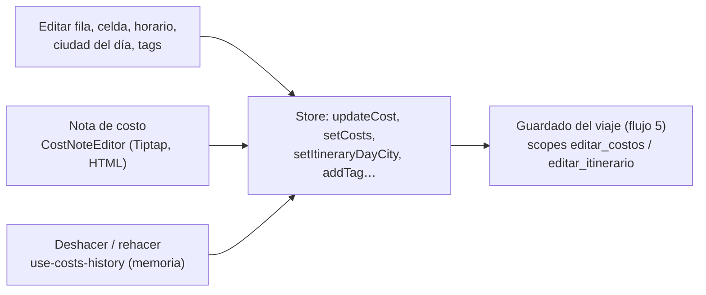

El itinerario visible son los costos agrupados por `itineraryDay`. Los campos `title`,
`description` y `activities` de cada día no tienen editor; las exportaciones sí los leen.

### 8. Viajeras, pagos y créditos

Pestaña "Viajeras" (`EnrolleesTab`, `EnrolleeCard`) y acciones del store.

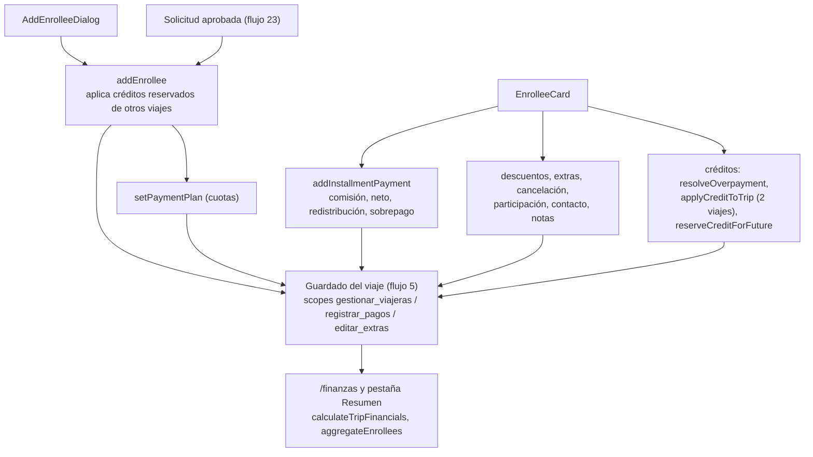

### 9. Logística y adjuntos de viajeras

`src/components/enrollees/LogisticsTab.tsx`, `src/lib/enrollee-files-storage.ts`.

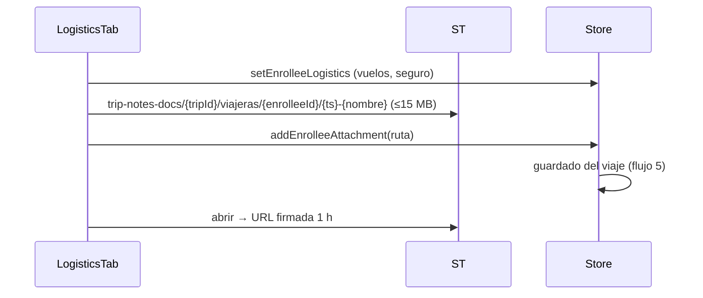

### 10. Notas, tareas y documentos

Pestaña "Notas" (`src/components/trip-notes/`) con React Query sobre `trip-notes.functions.ts`.

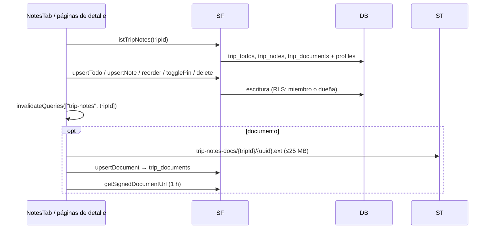

Las páginas `/viajes/$tripId/notas/$noteId` y `/todos/$todoId` editan con `RichEditor` y
guardan a los 800 ms.

### 11. Exportar PDF y Excel

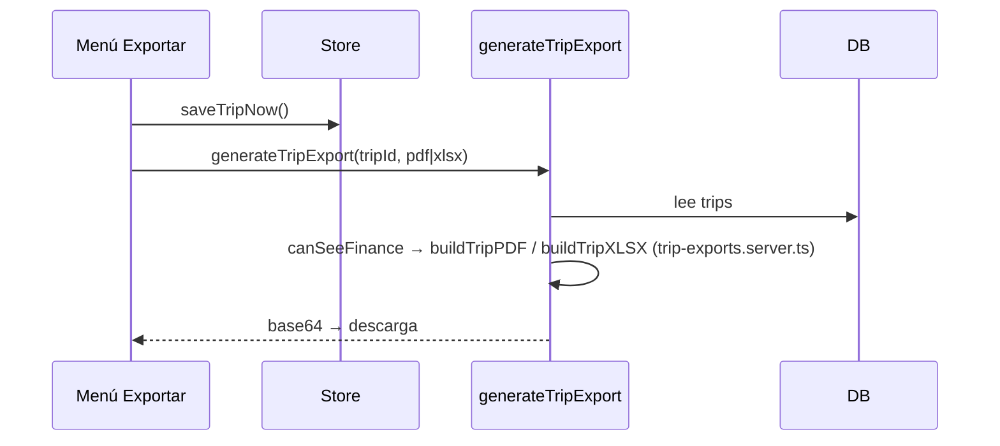

### 12. Papelera y borrado

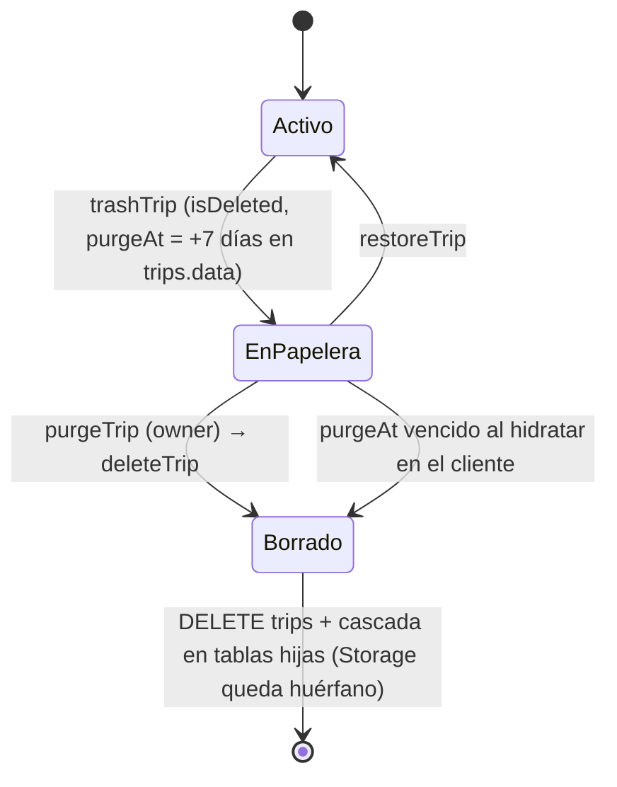

### 13. Actividad en vivo

Tras cada guardado, `notifyTripActivity` envía un broadcast al canal `trip-activity:<tripId>`.
`useTripActivity` lo muestra a las demás personas que tienen el viaje abierto, junto con la
sección en la que está cada una. No se guarda nada en la base.

---

## Página de venta

Reglas de diseño del editor: [`AGENTS.md`](../AGENTS.md). Documento: `EditorDocument` versión 4
en `src/lib/trip-editor.ts`.

### 14. Editar con autosave y deshacer

`src/components/editor/TripEditor.tsx` en `/viajes/$tripId/pagina`.

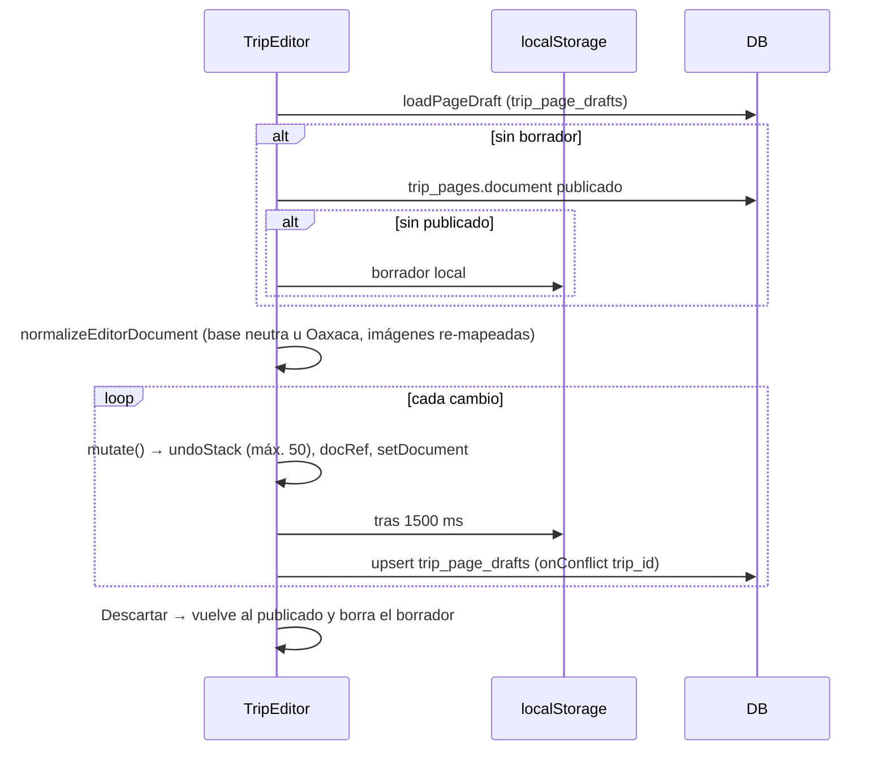

### 15. Editor ↔ iframe por postMessage

El lienzo es un iframe de `/preview?trip=<id>&mode=editor`. Todos los mensajes usan el mismo
origen y se valida `event.source`.

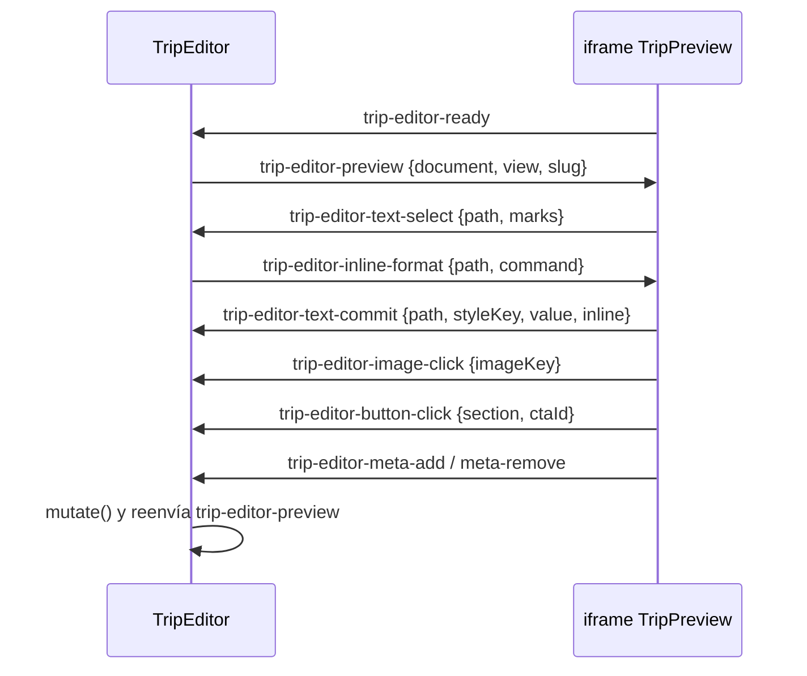

### 16. Vista previa con snapshot

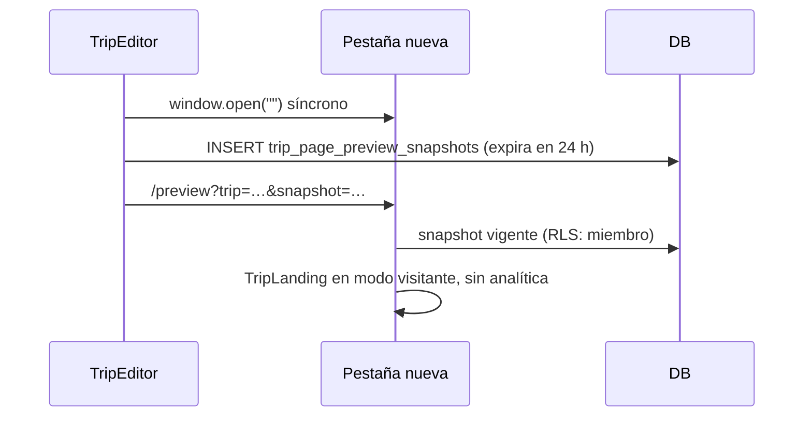

### 17. Publicar y servir /v/$slug

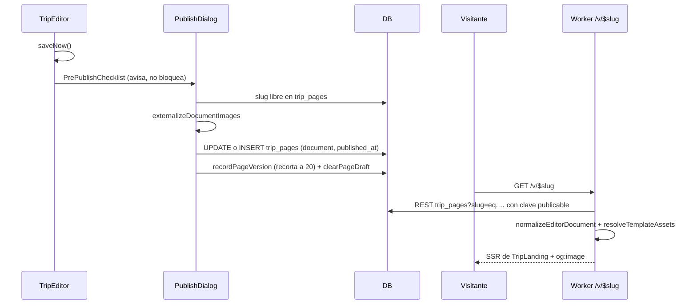

### 18. Resolución de CTAs

Cada botón tiene un `ctaId` estable y se resuelve con `resolveCtaLink` (`src/lib/cta-links.ts`).

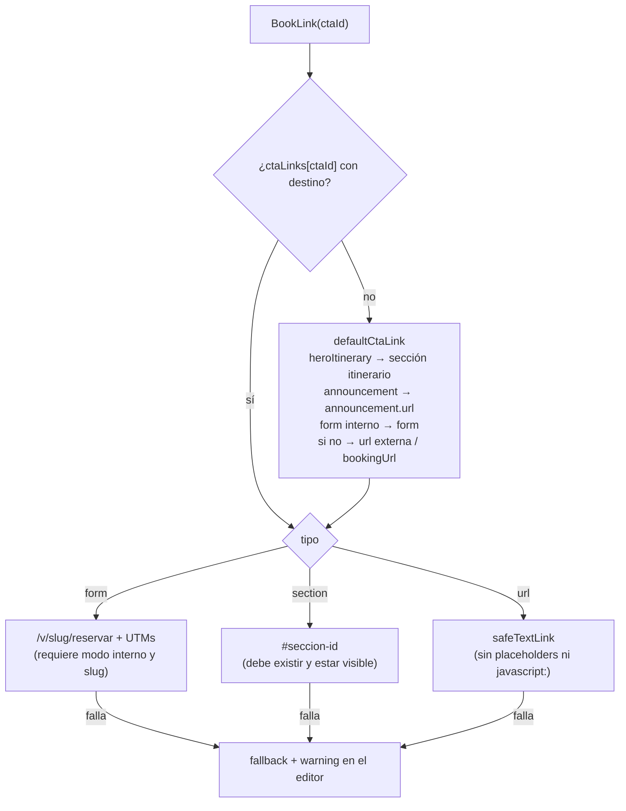

### 19. Imágenes de la landing

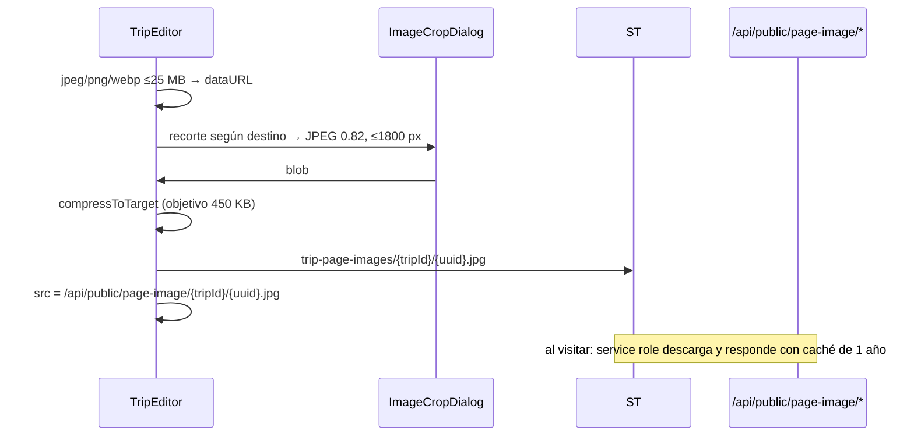

Las fotos de la plantilla de Oaxaca se sirven desde `public/template-assets/`. Las rutas del CDN
de Lovable guardadas en documentos viejos se re-mapean en `resolveTemplateAssets`.

### 20. Textos con IA

`AiCopyDialog` → `generateSalesCopy` (`src/lib/sales-copy.functions.ts`) →
`createResponsesModel` (`src/lib/ai-gateway.server.ts`) con `AI_API_KEY`, `AI_BASE_URL` y
`AI_MODEL`. La salida se valida con un esquema zod y se aplica con `mutate()`, así que se puede
deshacer. No toca la base.

---

## Recorrido público

### 21. Solicitud pública y correos

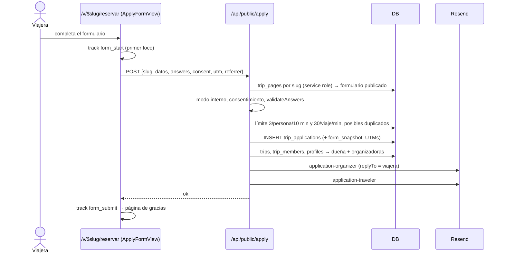

Un fallo de correo nunca afecta a la solicitud guardada. Sin `RESEND_API_KEY`, los correos se
registran en consola.

### 22. Analítica y métricas

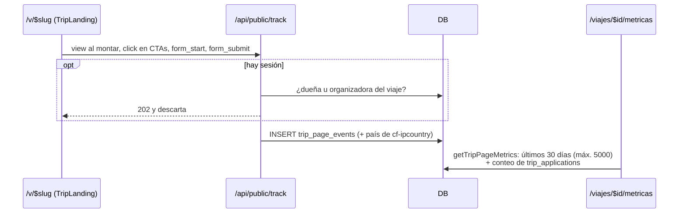

### 23. Panel de solicitudes

`/viajes/$tripId/solicitudes` trabaja con supabase-js y RLS sobre `trip_applications`,
`trip_application_notes` y `trip_application_events`. Cambiar estado, marcar contacto o
agregar notas escribe un evento. Aprobar crea la viajera con `addEnrollee` (flujo 8) y guarda
su id en `trip_applications.enrollee_id`. El dashboard muestra un punto de "nuevas" consultando
cada 30 s; lo visto se guarda por dispositivo en `localStorage`.
